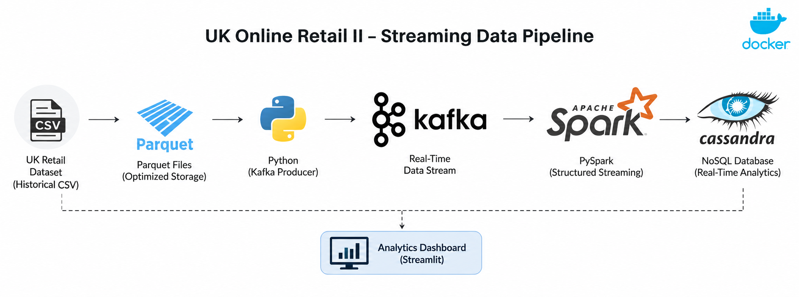

# UK Online Retail II – Streaming Data Engineering Pipeline

An end-to-end data engineering project that ingests historical UK Online Retail II transaction data into Apache Kafka, processes it using PySpark Structured Streaming, and stores the transformed transactions in Apache Cassandra.

The project demonstrates a simulated real-time streaming workflow using historical retail data replayed through Kafka at a configurable rate.

## System Architecture



## Project Overview

The pipeline uses the UK Online Retail II dataset, containing approximately 1.07 million transaction records.

The Python producer reads prepared Parquet files and publishes transaction records as JSON messages to Kafka. PySpark Structured Streaming reads those messages, validates the data, calculates transaction revenue, and writes the processed records to Cassandra.

**Important:** This is a simulated streaming project. Historical records are replayed through Kafka at a controlled rate; the source is not a live retail transaction feed.

## Technology Stack

| Technology | Purpose |
|---|---|
| Python | Data preparation and Kafka producer |
| Pandas | Data processing |
| Apache Kafka | Event ingestion and message streaming |
| Apache ZooKeeper | Kafka coordination |
| Apache Spark 3.5.5 | Structured Streaming and transformations |
| Apache Cassandra 4.1 | Processed transaction storage |
| Docker Compose | Container orchestration |
| Streamlit | Retail analytics dashboard |
| Plotly | Data visualization |
| DuckDB | Local analytical queries |
| PyArrow | Parquet processing |

## Dataset

**UK Online Retail II**

The dataset contains retail transactions with fields including:

- Invoice
- Stock Code
- Description
- Quantity
- Invoice Date
- Price
- Customer ID
- Country

The prepared dataset contains approximately 1,067,371 records.

The dataset and generated Parquet files are excluded from this repository to keep it lightweight. Obtain the dataset separately and prepare the Parquet files locally.

Expected Parquet directory:

```text
retail/
└── output/
    └── parquet/
        ├── retail_1.parquet
        └── retail_2.parquet
```

## Project Structure

```text
.
├── docker-compose.yml
├── requirements.txt
├── README.md
├── retail/
│   ├── producer/
│   │   ├── convert_to_parquet.py
│   │   └── retail_kafka_producer.py
│   ├── spark/
│   │   ├── retail_spark_cassandra.py
│   │   ├── retail_spark_full.py
│   │   └── retail_spark_stream.py
│   ├── analytics/
│   │   ├── retail_dashboard_streamlit.py
│   │   └── other analytics scripts
│   └── output/
│       └── parquet/
```

## Prerequisites

- Windows 10/11 or Linux
- Python 3.10
- Docker Desktop with Docker Compose
- Git
- UK Online Retail II dataset

## Installation and Setup

### 1. Clone the repository

```bash
git clone https://github.com/royal-eternity/uk-online-retail-streaming-data-pipeline.git

cd uk-online-retail-streaming-data-pipeline
```

### 2. Create a Python virtual environment

```bash
py -3.10 -m venv venv
```

Activate it on Windows:

```powershell
.\venv\Scripts\Activate.ps1
```

Install dependencies:

```bash
python -m pip install --upgrade pip
pip install -r requirements.txt
```

### 3. Prepare the dataset

Obtain the UK Online Retail II dataset and prepare the Parquet files using the data preparation script:

```bash
python retail/producer/convert_to_parquet.py
```

Ensure the generated files are available under:

```text
retail/output/parquet/
```

### 4. Start the infrastructure

Start the Kafka, ZooKeeper, Spark, and Cassandra services:

```bash
docker compose up -d zookeeper broker schema-registry control-center spark-master spark-worker cassandra_db
```

Check the running services:

```bash
docker compose ps
```

### 5. Create the Kafka topic

```bash
docker exec broker kafka-topics --bootstrap-server localhost:9092 --create --if-not-exists --topic retail_transactions_full --partitions 1 --replication-factor 1
```

### 6. Create the Cassandra keyspace and table

Create the keyspace:

```bash
docker exec cassandra cqlsh -e "CREATE KEYSPACE IF NOT EXISTS spark_streams WITH replication = {'class': 'SimpleStrategy', 'replication_factor': 1};"
```

Create the transaction table:

```bash
docker exec cassandra cqlsh -e "CREATE TABLE IF NOT EXISTS spark_streams.retail_transactions_v2 (invoice text, stock_code text, invoice_date text, kafka_partition int, kafka_offset bigint, description text, quantity int, price double, customer_id double, country text, revenue double, processed_at timestamp, PRIMARY KEY ((invoice), stock_code, kafka_partition, kafka_offset));"
```

### 7. Produce transaction events to Kafka

Run the producer from the project directory:

```bash
python retail/producer/retail_kafka_producer.py --limit 1067371 --rate 200
```

Options:

- `--limit`: Number of transaction records to publish.
- `--rate`: Target publishing rate in records per second.
- `--bootstrap`: Kafka bootstrap server; defaults to `localhost:9092`.
- `--topic`: Kafka topic; defaults to `retail_transactions_full`.

For a smaller test:

```bash
python retail/producer/retail_kafka_producer.py --limit 100 --rate 20
```

### 8. Process Kafka messages with Spark

After the producer has finished publishing, run:

```bash
docker compose up spark-app
```

The Spark application:

1. Reads transaction messages from Kafka.
2. Parses JSON messages using a defined schema.
3. Filters invalid records.
4. Calculates transaction revenue.
5. Adds processing timestamps.
6. Writes transformed records into Cassandra.

Spark uses a persistent checkpoint directory to track Kafka offsets and streaming progress.

The current Spark job uses an `availableNow` trigger: it processes the messages available when it starts and then exits.

### 9. Verify the Cassandra output

Check stored transactions:

```bash
docker exec cassandra cqlsh -e "SELECT invoice, stock_code, quantity, price, revenue FROM spark_streams.retail_transactions_v2 LIMIT 10;"
```

Check the number of processed records:

```bash
docker exec cassandra cqlsh -e "SELECT COUNT(*) FROM spark_streams.retail_transactions_v2;"
```

## Monitoring

| Service | Local URL |
|---|---|
| Spark Master UI | http://localhost:9090 |
| Kafka Control Center | http://localhost:9021 |
| Schema Registry | http://localhost:8081 |

## Key Features

- Historical retail data preparation and Parquet storage.
- Configurable Kafka event production rate.
- Kafka-based transaction ingestion.
- PySpark Structured Streaming transformations.
- Data validation and revenue calculation.
- Cassandra storage with Kafka partition and offset tracking.
- Docker-based local infrastructure.
- Retail analytics and visualization scripts.

## Learning Outcomes

- Building an end-to-end data engineering pipeline.
- Working with Apache Kafka and event-driven ingestion.
- Processing streaming data with PySpark.
- Designing Cassandra tables for transaction storage.
- Handling structured data with Python and Parquet.
- Running distributed data services using Docker Compose.

## Author

**Royal Chodagiri**

GitHub: https://github.com/royal-eternity

---

If you find this project useful, feel free to star the repository.
